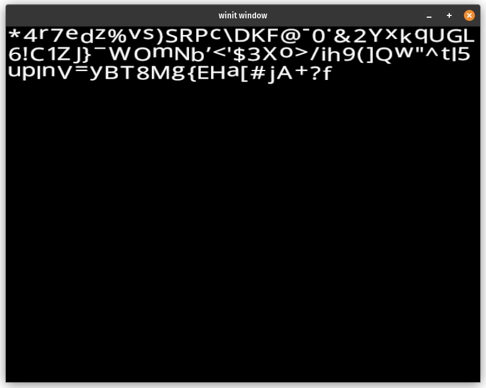
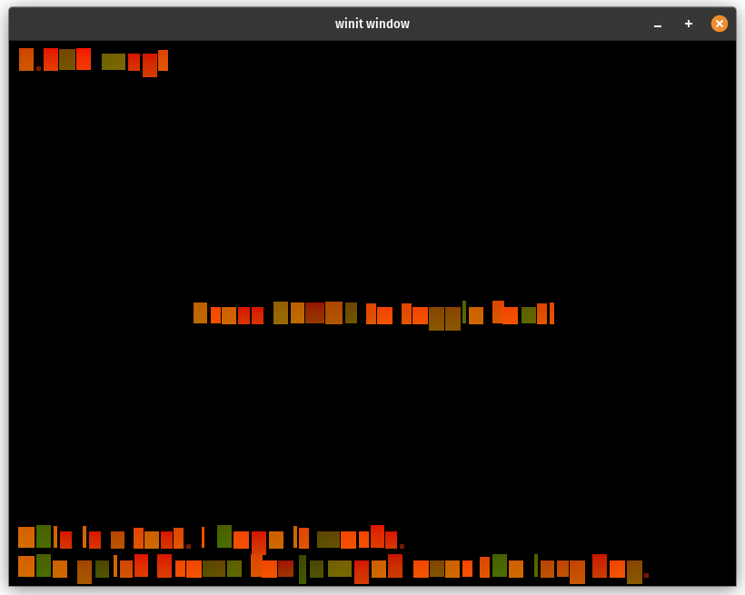
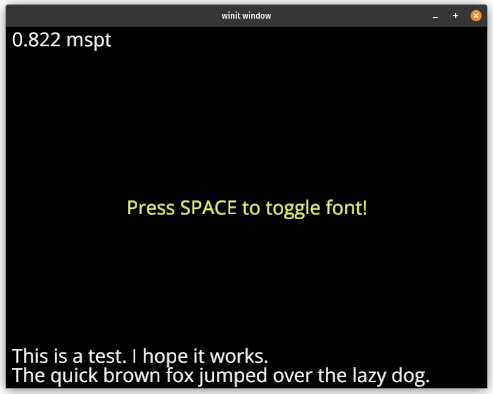
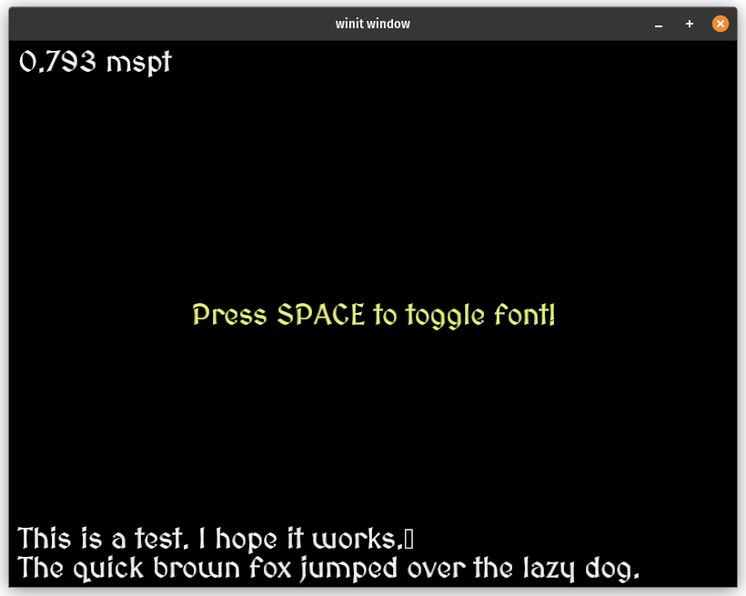
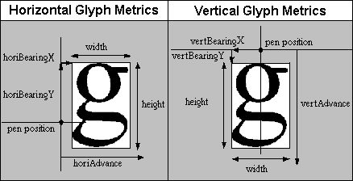

# Drawing Text

<!-- Some intro about writing fonts -->

While there are tons of libraries that allow you to draw text,
I've allows wanted to experiment with drawing it from scratch.
Depending on the language and the font, text rendering can vary
from being simple to being very complex. For English and mostly
ASCII characters it's fairly simple. Let's get into it!

## Bitmaps Fonts

One of the oldest ways to draw text is to take a texture with
all the letters and other glyphs you want to render and then
draw quads with uv coordinates matching the letters you want.

The texture used for storing the glyphs is called a texture
atlas. For a simple sans serif font the atlas I'm using looks
like this:



You could find a font atlas online, or you can make one yourself.
I created one by loading the font with [fontdue](https://docs.rs/fontdue).
and storing the glyph data in a texture. I created this by computing
the coverage of the glyph using `fontdue`.

```rust
let (metrics, coverage) = font.rasterize(c, glyph_scale);
```

Then I use a simple shelf packing method where each glyph gets
rendered to the texture one after another until there's no space,
then it moves down to the next line. There are more advanced
techniques, but given glyphs are usually roughly the same size by
design, this naive method works just fine.

With the text in a texture you can then render out quads with
texcoords that correspond to the different glyphs. Here's an example
of text rendering using just the texcoords as color.



Here's the text with a sans-serif font:



And here's the text with a fancy medieval style font:



## Positioning Glyphs

Once you get the glyphs into an atlas this is probably the
trickiest part of rendering text (unless your doing fancy
effects). Each font has rules about how each glyph should be
positioned. Here's a diagram I found on line of the different
measurements a glyph can have:



In this showcase I didn't include all the the possible values.
Here's the struct I created to store the metrics I used in this
demo:

```rust
#[derive(Debug)]
pub struct Glyph {
    offset: Vec2,
    h_advance: f32,
    v_advance: f32,
    texture_region: Option<TextureRegion>,
}

#[derive(Debug)]
pub struct TextureRegion {
    min: Vec2,
    max: Vec2,
    min_uv: Vec2,
    max_uv: Vec2,
}
```

I save this data as I construct the texture atlas. I use this data
when constructing a vertex buffer to use to render the text.
Here's the function I use to create the vertex buffer:

```rust
fn layout_glyphs(
    font: &BitmapFont,
    text: &str,
    position: Vec2,
    color: Vec4,
) -> (Vec<u32>, Vec<u8>, FontUniforms) {
    let mut vertices = Vec::new();
    let mut indices = Vec::new();
    let mut current_position = Vec2::ZERO;
    let mut extents = Vec2::ZERO;

    for c in text.chars() {
        if c == '\n' {
            current_position.y += font.line_height;
        }
    }

    let mut previous_c = None;

    for c in text.chars() {
        let glyph = font.glyph(c).unwrap();

        if c == '\n' {
            previous_c = None;
            current_position.x = 0.0;
            current_position.y -= font.line_height;
            continue;
        }

        if c.is_control() {
            continue;
        }

        if let Some(region) = &glyph.texture_region {
            let start_vertex = vertices.len() as u32;

            let size = region.max - region.min;
            let mut min = current_position + glyph.offset;
            let mut max = min + size;

            if let Some(pc) = previous_c
                && let Some(&kern) = font.kerning.get(&(pc, c))
            {
                min.x += kern;
                max.x += kern;
            }

            // Update the bounds with the next character
            extents = max;

            vertices.push(FontVertex {
                position: min,
                uv: vec2(region.min_uv.x, region.max_uv.y),
                color,
            });
            vertices.push(FontVertex {
                position: vec2(max.x, min.y),
                uv: vec2(region.max_uv.x, region.max_uv.y),
                color,
            });
            vertices.push(FontVertex {
                position: max,
                uv: vec2(region.max_uv.x, region.min_uv.y),
                color,
            });
            vertices.push(FontVertex {
                position: vec2(min.x, max.y),
                uv: vec2(region.min_uv.x, region.min_uv.y),
                color,
            });

            indices.push(start_vertex);
            indices.push(start_vertex + 1);
            indices.push(start_vertex + 2);
            indices.push(start_vertex);
            indices.push(start_vertex + 2);
            indices.push(start_vertex + 3);
        }

        previous_c = Some(c);

        current_position.x += glyph.h_advance;

        // Only used for vertical fonts
        current_position.y += glyph.v_advance;
    }

    let vertex_bytes: &[u8] = cast_slice(&vertices);
    let mut bytes: Vec<u8> =
        Vec::with_capacity(std::mem::size_of::<FontUniforms>() + vertex_bytes.len());

    let uniforms = FontUniforms::new(position, extents);
    let uniform_bytes = bytes_of(&uniforms);

    // Put the uniform data at the start of the buffer
    bytes.extend(uniform_bytes);

    // and the vertices at the end
    bytes.extend(vertex_bytes);

    (indices, bytes, uniforms)
}
```

You may have noticed that I'm baking the text uniforms into
the same buffer as the vertices. Buffers can hold any data you
want so if the text isn't going to change why not just bundle
everything in one buffer? This does make creating, updating,
and using the buffers a little more involved. For example here's
an excerpt of the `TextPipeline` I created:

```rust

pub struct TextPipeline {
    debug: wgpu::RenderPipeline,
    draw_glyph: wgpu::RenderPipeline,
}

impl TextPipeline {
    // ...

    pub fn buffer_text(
        &self,
        device: &wgpu::Device,
        font: Arc<BitmapFont>,
        font_binder: &FontBinder,
        sampler: &wgpu::Sampler,
        text: &str,
        position: Vec2,
        color: Vec4,
    ) -> TextBuffer {
        let (indices, bytes, uniforms) = layout_glyphs(&font, text, position, color);

        let uniform_vertex_buffer = device.create_buffer_init(&BufferInitDescriptor {
            label: Some(text),
            contents: &bytes,
            usage: wgpu::BufferUsages::VERTEX
                | wgpu::BufferUsages::UNIFORM
                | wgpu::BufferUsages::COPY_DST,
        });
        let index_buffer = device.create_buffer_init(&BufferInitDescriptor {
            label: Some(text),
            contents: bytemuck::cast_slice(&indices),
            usage: wgpu::BufferUsages::INDEX | wgpu::BufferUsages::COPY_DST,
        });

        let glyph_atlas_binding = font_binder.bind_font(device, &font, sampler);
        let uniforms_binding = font_binder.bind_uniforms(device, &uniform_vertex_buffer);

        TextBuffer {
            uniform_vertex_buffer,
            index_buffer,
            glyph_atlas_binding,
            uniforms_binding,
            num_indices: indices.len() as u32,
            uniforms,
            font: font.clone(),
        }
    }

    pub fn debug_glyph_texture(&self, font: &FontBinding, pass: &mut wgpu::RenderPass<'_>) {
        pass.set_pipeline(&self.debug);
        pass.set_bind_group(0, &font.bind_group, &[]);
        pass.draw(0..3, 0..1);
    }

    pub fn draw_text(
        &self,
        text: &TextBuffer,
        camera: &CameraBinding,
        pass: &mut wgpu::RenderPass<'_>,
    ) {
        pass.set_pipeline(&self.draw_glyph);
        pass.set_bind_group(0, text.glyph_atlas_binding.bind_group(), &[]);
        pass.set_bind_group(1, camera.bind_group(), &[]);
        pass.set_bind_group(2, text.uniforms_binding.bind_group(), &[]);

        // Since the uniform buffer takes up the first part of
        // the buffer we need to tell wgpu to start after that
        pass.set_vertex_buffer(
            0,
            text.uniform_vertex_buffer
                .slice((std::mem::size_of::<FontUniforms>() as u64)..),
        );

        pass.set_index_buffer(text.index_buffer.slice(..), wgpu::IndexFormat::Uint32);
        pass.draw_indexed(0..text.num_indices, 0, 0..1);
    }
}
```

The `FontBinder` is a custom struct I use to simplify creating
`BindGroup`s.

```rust
pub struct FontBinder {
    glyph_atlas_layout: wgpu::BindGroupLayout,
    text_buffer_layout: wgpu::BindGroupLayout,
}

impl FontBinder {
    pub fn new(device: &wgpu::Device) -> Self {
        let glyph_atlas_layout =
            device.create_bind_group_layout(&wgpu::BindGroupLayoutDescriptor {
                label: Some("FontBinder::glyph_atlas_layout"),
                entries: &[
                    wgpu::BindGroupLayoutEntry {
                        binding: 0,
                        visibility: wgpu::ShaderStages::FRAGMENT,
                        ty: wgpu::BindingType::Sampler(wgpu::SamplerBindingType::Filtering),
                        count: None,
                    },
                    wgpu::BindGroupLayoutEntry {
                        binding: 1,
                        visibility: wgpu::ShaderStages::FRAGMENT,
                        ty: wgpu::BindingType::Texture {
                            sample_type: wgpu::TextureSampleType::Float { filterable: true },
                            view_dimension: wgpu::TextureViewDimension::D2,
                            multisampled: false,
                        },
                        count: None,
                    },
                ],
            });

        let text_buffer_layout =
            device.create_bind_group_layout(&wgpu::BindGroupLayoutDescriptor {
                label: Some("FontBinder::text_buffer_layout"),
                entries: &[wgpu::BindGroupLayoutEntry {
                    binding: 0,
                    visibility: wgpu::ShaderStages::VERTEX,
                    ty: wgpu::BindingType::Buffer {
                        ty: wgpu::BufferBindingType::Uniform,
                        has_dynamic_offset: false,
                        min_binding_size: None,
                    },
                    count: None,
                }],
            });

        Self {
            glyph_atlas_layout,
            text_buffer_layout,
        }
    }

    pub fn bind_font(
        &self,
        device: &wgpu::Device,
        font: &BitmapFont,
        sampler: &wgpu::Sampler,
    ) -> FontBinding {
        let bind_group = device.create_bind_group(&wgpu::BindGroupDescriptor {
            label: None,
            layout: &self.glyph_atlas_layout,
            entries: &[
                wgpu::BindGroupEntry {
                    binding: 0,
                    resource: wgpu::BindingResource::Sampler(sampler),
                },
                wgpu::BindGroupEntry {
                    binding: 1,
                    resource: wgpu::BindingResource::TextureView(&font.texture),
                },
            ],
        });

        FontBinding { bind_group }
    }

    fn bind_uniforms(
        &self,
        device: &wgpu::Device,
        uniform_buffer: &wgpu::Buffer,
    ) -> FontUniformsBinding {
        FontUniformsBinding {
            bind_group: device.create_bind_group(&wgpu::BindGroupDescriptor {
                label: Some("text bind_group"),
                layout: &self.text_buffer_layout,
                entries: &[wgpu::BindGroupEntry {
                    binding: 0,
                    resource: wgpu::BindingResource::Buffer(wgpu::BufferBinding {
                        buffer: uniform_buffer,
                        offset: 0,
                        size: NonZero::new(std::mem::size_of::<FontUniforms>() as _),
                    }),
                }],
            }),
        }
    }
}
```

## Shaders

Not much to see here. Since we are just drawing textured quads
the shader is pretty simple, but I'll included it here anyways.

```wgsl
struct FontVertex {
    @location(0)
    position: vec2<f32>,
    @location(1)
    uv: vec2<f32>,
    @location(2)
    color: vec4<f32>,
}

struct VertexOutput {
    @builtin(position)
    clip_position: vec4<f32>,
    @location(0)
    uv: vec2<f32>,
    @location(1)
    color: vec4<f32>,
}

struct Camera {
    view: mat4x4<f32>,
    proj: mat4x4<f32>,
    view_proj: mat4x4<f32>,
}

struct FontUniforms {
    position: vec2<f32>,
    // Unused, but needed for alignment
    extents: vec2<f32>,
}


@group(0)
@binding(0)
var font_sampler: sampler;
@group(0)
@binding(1)
var font_texture: texture_2d<f32>;

@group(1)
@binding(0)
var<uniform> camera: Camera;

@group(2)
@binding(0)
var<uniform> uniforms: FontUniforms;

@vertex
fn vs_fullscreen(
    @builtin(vertex_index) in_vertex_index: u32,
) -> VertexOutput {
    var out: VertexOutput;
    // Create fullscreen triangle
    let x = f32((in_vertex_index << 1u) & 2u);
    let y = f32(in_vertex_index & 2u);
    out.clip_position = vec4<f32>(x * 2.0 - 1.0, y * 2.0 - 1.0, 0.0, 1.0);
    out.uv = vec2<f32>(x, 1.0 - y);
    out.color = vec4(1.0);
    return out;
}

@vertex
fn vs_glyph(
    v: FontVertex,
) -> VertexOutput {
    var out: VertexOutput;

    out.clip_position = camera.view_proj * vec4(v.position + uniforms.position, 0.0, 1.0);
    out.uv = v.uv;
    out.color = v.color;

    return out;
}

@fragment
fn fs_glyph(in: VertexOutput) -> @location(0) vec4<f32> {
    let coverage = textureSample(font_texture, font_sampler, in.uv).r;
    var col = in.color;
    col.a *= coverage;
    return col;
}
```

The main thing is that the color from the texture is actually the "coverage"
of the glyph or how much of that pixel is covered by the glyph. We just
use the coverage as the alpha value of the pixel.

## Demo

<WasmExample example="text"></WasmExample>

## Supporters

Special thanks to these supporters from my [Patreon](https://www.patreon.com/c/sotrh)!

* David Laban
* Bernard Llanos
* Ian Gowen
* Aron Granberg
* 折登 樹
* Julius Liu
* Jani Turkia
* Lions Heart
* IC
* Filip
* Kosuke Ohira
